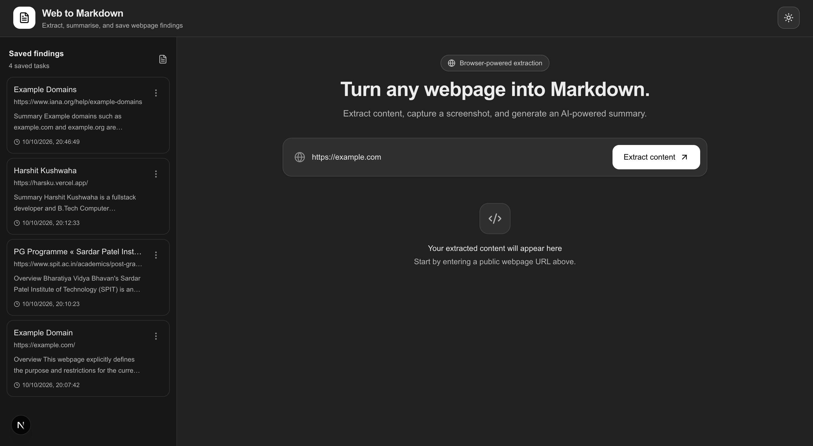
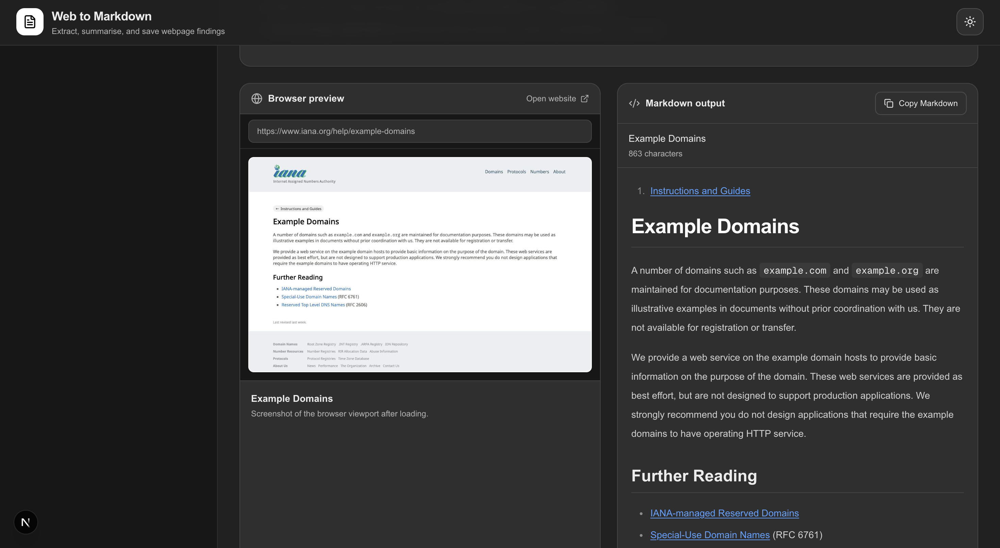

# NextJS Web-Scraper Summarrizer

A web scraping tool that captures webpage screenshots, converts page
content into readable Markdown, and generates AI-powered summaries with
Gemini 2.5 Flash.

## Demo

[Watch the demo video](https://drive.google.com/file/d/1RUSHhSiL6oddReoxfA92aUEkNpaaXjD4/view?usp=sharing)

## Screenshots

### Webpage preview and extracted content



### AI summary and saved findings



## Features

- Scrape public webpages with Puppeteer and Google Chrome.
- Generate summaries with Gemini 2.5 Flash.
- Convert HTML into Markdown using Turndown.
- Preview webpage screenshots alongside extracted Markdown.
- Save completed findings in browser local storage.
- Light and dark themes.

## Workflow

1.  Enter a webpage URL.
2.  Puppeteer opens the page in Chrome and extracts its content.
3.  Turndown converts the HTML into Markdown.
4.  The screenshot and Markdown appear in the interface.
5.  Gemini generates a summary through a separate API request.
6.  Once summarization completes, the summary, screenshot, URL, and
    Markdown are saved in local storage.

## Local Setup

### 1. Install dependencies

```bash
git clone https://github.com/hasrku/nextjs-web-summarizer
cd web-to-markdown
npm install
```

### 2. Configure environment variables

Create `.env.local` in the project root:

```env
GEMINI_API_KEY=your_gemini_api_key
CHROME_EXECUTABLE_PATH="/Applications/Google Chrome.app/Contents/MacOS/Google Chrome"
```

Get a Gemini API key from [Google AI
Studio](https://aistudio.google.com/). Ensure Chrome is installed on
your Mac; if it is in a different location, update
`CHROME_EXECUTABLE_PATH` to its executable path.

### 3. Start the development server

1. start the server

```bash
npm run dev
```

2. Open in browser

```bash
http://localhost:3000
```

## Deployment Limitation

The current scraper will not work on Vercel as configured. It relies on
a Google Chrome executable installed on the local Mac, using a path that
does not exist in Vercel's deployment environment.
